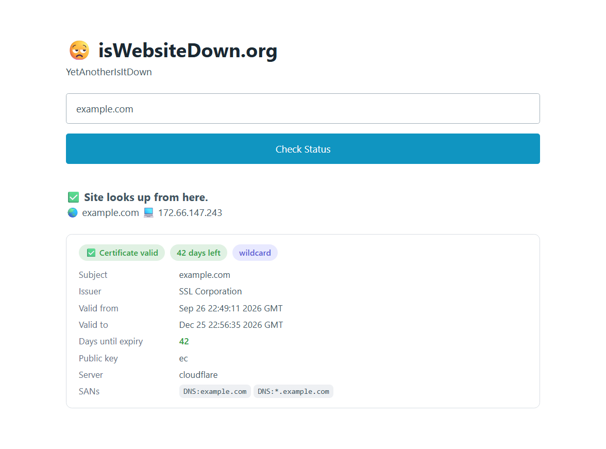

# YAIID - Yet Another Is It Down Checker



YAIID is a simple Cloudflare Worker that checks whether a URL or IP address is accessible using a TCP connection. This application can be useful for monitoring the availability of websites or servers.

## Getting Started

Clone the repository:

```
git clone https://github.com/altan-me/yaiid
```

Install the required dependencies:

```
cd yaiid
npm install
```

Run locally with Wrangler:

```
npm run dev
```

Deploy to Cloudflare Workers:

```
npm run deploy
```

Then attach a custom domain (e.g. `iswebsitedown.org`) to the Worker in the Cloudflare dashboard.

## How it Works

YAIID checks the target with an HTTP HEAD request via `fetch()` — port 80 first, then 443 for HTTPS-only hosts; any HTTP response (even an error status) means the site is up — and reports the resolved IP via DNS-over-HTTPS. `POST /ping` accepts a domain or IP address. Using `fetch()` keeps `/ping` working on every Workers plan (raw `connect()` sockets need the TCP sockets capability).

`POST /check-tls-stats` accepts a FQDN and inspects the certificate server-side: it opens a raw TCP connection to port 443 via `connect()`, sends a minimal TLS 1.2 ClientHello, reads the plaintext Certificate handshake message, and parses the leaf certificate with `node:crypto`'s `X509Certificate` (Workers cannot read the peer certificate of an outbound TLS connection directly). It also performs a live HTTPS HEAD request, which validates the live certificate and returns the `server` header.

Both POST endpoints are rate limited to 20 requests per minute per IP via the Workers [Rate Limiting binding](https://developers.cloudflare.com/workers/runtime-apis/bindings/rate-limit/) (`ratelimits` in `wrangler.jsonc`). Note the binding counts per Cloudflare location, so the effective limit is approximate.

Run the unit tests (TLS handshake parser, input validators) with:

```
npm test
```

Static assets (pages, CSS, JS, images, `robots.txt`, `/.well-known/security.txt`) are served from `public/` via [Workers Static Assets](https://developers.cloudflare.com/workers/static-assets/), with a custom `404.html`. Security headers and cache policy are set via `public/_headers` for assets and in `src/index.js` for API responses.

## Differences from the old Node/Express version

- ICMP ping and raw TCP checks are not used for `/ping` (raw sockets need the TCP sockets capability, not available on every plan, and ICMP is impossible in Workers); it does an HTTP-level check via `fetch()` instead, with the IP resolved via DoH.
- Certificate details are extracted with a minimal TLS 1.2 handshake over `connect()` instead of `getPeerCertificate()` (not implemented in workerd); on plans without the TCP sockets capability, or for TLS 1.3-only servers, the endpoint falls back to the live HTTPS check (status + `server` header, no cert fields).

## Contributing

Contributions to YAIID are welcome! If you find a bug or have a suggestion for a new feature, please open an issue on this repository. If you'd like to contribute code to YAIID, please fork this repository and submit a pull request.
